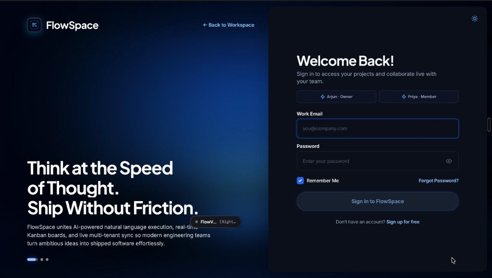

# FlowSpace: AI-Native Team Task Workspace

<p align="center">
  
</p>

FlowSpace is a multi-tenant project management and task execution workspace designed to remove the friction of traditional issue trackers. Instead of manually filling out repetitive forms and clicking through dropdown menus, team members can speak or type in natural language to create, update, organize, and track tasks in real time.

The system combines a reactive single-page frontend, a stateless serverless backend, a relational database with strict ACID transaction guarantees, and an intelligent natural language processing pipeline powered by Groq and the FlowVoice speech engine.

---

## What the Project Is

FlowSpace is an engineering-first workspace operating system built to streamline how software teams capture and manage work. It brings together conversational natural language processing, voice transcription, real-time multi-user synchronization, and a modern glassmorphism interface.

Traditional project management platforms such as Jira, Asana, and Trello are built around heavy forms, rigid configuration trees, and multi-step manual data entry. FlowSpace approaches task management from a voice-first, intent-driven perspective: team members can communicate naturally in English or Hinglish, while the underlying AI compiler translates human intent into structured, validated database records.

---

## Architectural Tech Stack

### Frontend
- **Framework:** React 18 with Vite for fast HMR and optimized production bundles.
- **State Management & Data Synchronization:** TanStack React Query (v5) for server-state caching, background revalidation, and optimistic UI mutations.
- **Styling & Design System:** Tailwind CSS with custom glassmorphism utilities, backdrop-filter blurs, and hardware-accelerated CSS variables.
- **Drag-and-Drop:** @dnd-kit/core and @dnd-kit/sortable for touch- and pointer-accessible Kanban reordering.
- **Realtime Client:** pusher-js for WebSocket presence subscriptions and cross-client event synchronization.
- **Icons:** Lucide React for consistent, lightweight iconography.

### Backend
- **Runtime & Framework:** Node.js (v20+) with Express.js running as stateless serverless functions compatible with Vercel.
- **Authentication & Security:** JSON Web Tokens (JWT) signed with HMAC-SHA256 and transmitted exclusively via httpOnly, SameSite=Lax cookies with bcrypt password hashing (12 salt rounds).
- **Rate Limiting:** express-rate-limit protecting authentication endpoints and AI inference endpoints against abuse.
- **Validation:** Zod schemas enforcing strict runtime contracts for all API inputs, database payloads, and LLM structured outputs.

### Database & Persistence
- **Engine:** MySQL 8 locally and TiDB Cloud Serverless in production.
- **Driver:** mysql2/promise using parameterized queries for SQL injection prevention.
- **Connection Management:** Cached global connection pool with warm-instance connection reuse and concurrency limits.
- **Transactions:** Hand-written SQL with explicit ACID transactions (BEGIN, COMMIT, ROLLBACK) and row-level locks for sequential counter generation. No bulky ORM layer.

### AI & Speech Processing
- **Language Models:** Groq Llama 3.3 70B Versatile in deterministic JSON mode (temperature: 0) with automatic retry and graceful fallback to Llama 3.1 8B Instant.
- **Speech Recognition:** Groq Whisper Large v3 for multilingual voice transcription.
- **FlowVoice Engine Integration:** Custom speech-to-intent pipeline performing filler word removal, Hinglish translation, fuzzy assignee matching, and relative date resolution.

---

## Integration with Flow and FlowVoice

A central component of this platform is the integration between the web workspace and the Flow / FlowVoice speech processing architecture.

FlowVoice is engineered to solve a common failure in voice-to-text systems: raw transcription captures spoken hesitation, verbal fillers (such as "um", "uh", "matlab", "basically"), and mixed colloquial phrasing that degrades database record quality.

### How FlowVoice Enhances the Workflow:

1. **Vocal Cleanup and Normalization:** FlowVoice removes vocal pauses, stuttered words, and spoken filler phrases while preserving the technical intent of the user.
2. **Bilingual Speech Understanding:** Team members often speak in mixed vernacular, such as Hinglish ("Rahul ke liye urgent bug fix kal tak schedule karo"). FlowVoice accurately transcribes the Romanized Hinglish phonetics, interprets "kal tak" as tomorrow's calendar date, identifies "urgent" as a priority level, and resolves "Rahul" to the correct workspace user ID.
3. **Context Injection:** When an audio payload is received, FlowVoice injects active workspace metadata (project keys, member names, and open task titles) into the compilation prompt. This allows the model to match fuzzy speech ("assign to Priya") with exact user records, dramatically increasing data entry speed and accuracy.
4. **Single-Action Hardware Hotkey:** FlowVoice is bound to a dedicated push-to-talk hotkey (Right Alt / AltRight), allowing developers and managers to record voice inputs with one keypress without lifting their hands from the keyboard.

---

## The Frosted Glass UI Effect (CSS Architecture)

FlowSpace features a custom-engineered Glass UI (Glassmorphism) designed to replace the flat, sterile, and outdated visual patterns common in legacy enterprise software.

### Design Principles:

- **Depth Through Translucency:** Interfaces use multi-layered semi-transparent surfaces (`rgba(255, 255, 255, 0.7)` in light mode, and `rgba(15, 23, 42, 0.75)` in dark mode) combined with CSS `backdrop-filter: blur(12px)`. This creates a sense of physical depth where underlying content is softly visible without sacrificing readability.
- **Specular Highlights:** Card borders use subtle gradients with varying opacities (`border: 1px solid rgba(255, 255, 255, 0.2)`), simulating light catching the bevelled edge of a physical pane of glass.
- **Dark Mode Spotlight Gradient:** The dark mode interface avoids dull monochrome greys. It incorporates a deep blue spotlight gradient background (`dark-bg.jpg`) that provides vibrant focal illumination behind translucent workspace panels, keeping users visually engaged during extended working sessions.
- **Tactile Micro-Interactions:** Hover states, active buttons, and modal dialogs feature smooth transitions, subtle scaling, and glow shifts that provide clear visual feedback for every user interaction.

---

## How the Database Stores Values: Step-by-Step Lifecycle

The database uses a normalized schema with 7 relational tables: `users`, `workspaces`, `memberships`, `projects`, `tasks`, `task_tags`, and `activities`. Data is stored and updated through strict, step-by-step transactional workflows.

```
+-----------+       +---------------+       +------------+
|   users   |----<--|  memberships  |-->----| workspaces |
+-----------+       +---------------+       +------------+
      |                                           |
      | (assignee / creator)                      | (contains)
      v                                           v
+-----------+       +---------------+       +------------+
|   tasks   |----<--|   task_tags   |       |  projects  |
+-----------+       +---------------+       +------------+
      |
      | (audit log reference)
      v
+-----------+
|activities |
+-----------+
```

### Step 1: User Signup and Workspace Scaffolding
1. The user submits their name, email, password, and optional workspace name to `/api/auth/signup`.
2. The server hashes the password with bcrypt (12 rounds) and opens a database transaction via `mysql2/promise`.
3. The server inserts a new record into `users`.
4. The server creates a default workspace in `workspaces` (with `task_counter = 0`).
5. An entry is added to `memberships` linking the user to the workspace with the role `OWNER`.
6. A default project (key: `FLOW`) is inserted into `projects`.
7. The transaction is committed. If any insert fails, the transaction is rolled back completely, preventing orphan records.

### Step 2: Atomic Task Creation with Concurrency Safety
A major challenge in multi-user task software is generating clean, sequential task codes (such as `FLOW-1`, `FLOW-2`) without race conditions when two teammates create tasks at the exact same millisecond.

FlowSpace resolves this using row-level database locks:
1. When a task creation request arrives (via manual form or confirmed AI preview), the server initiates `START TRANSACTION`.
2. The server executes:
   ```sql
   SELECT task_counter FROM workspaces WHERE id = ? FOR UPDATE;
   ```
   The `FOR UPDATE` clause places an exclusive lock on that specific workspace row. Concurrent requests must wait their turn.
3. The server increments the counter in memory, updates `workspaces SET task_counter = task_counter + 1`, and formats the task code (for example, `FLOW-5`).
4. The task is inserted into `tasks` with `workspace_id`, `project_id`, `code`, `title`, `description`, `status`, `priority`, `due_date`, `assignee_id`, `created_by`, `source` (`MANUAL`, `AI_TEXT`, or `AI_VOICE`), and `position`.
5. If tags are provided, each tag is inserted into `task_tags` (`task_id`, `tag`).
6. An entry is written to `activities` (`workspace_id`, `actor_id`, `task_id`, `type = 'task.created'`, `meta = JSON`).
7. The transaction is committed.
8. Only after the database commit succeeds does the server broadcast the `task.created` event through Pusher Channels to all connected teammates.

### Step 3: Status Transitions and Optimistic Reordering
1. When a user drags a card on the Kanban board from `IN_PROGRESS` to `DONE`, the client updates its local React Query cache immediately for zero-latency interaction.
2. The client fires a `PATCH /api/workspaces/:wid/tasks/:id` request containing `{ status: "DONE" }` and the client's `X-Socket-Id`.
3. The server verifies that the user is an active member of the workspace via `memberships`.
4. The server executes an `UPDATE tasks SET status = ?, updated_at = NOW() WHERE id = ? AND workspace_id = ?`.
5. An audit entry is inserted into `activities` with `{ previousStatus: "IN_PROGRESS", newStatus: "DONE" }`.
6. The server triggers a Pusher broadcast. By passing `socket_id`, Pusher excludes the sender, preventing duplicate re-renders on the author's screen while updating all other connected clients in real time.
7. If the network fails or the server returns an error, React Query rolls back the drag action to its previous position automatically.

### Step 4: Keyset Pagination and Historical Audit Trail
1. The activity feed avoids inefficient `OFFSET` queries that slow down as data grows.
2. Instead, it queries with cursor-based keyset pagination:
   ```sql
   SELECT a.*, u.name as actor_name, t.code as task_code
   FROM activities a
   LEFT JOIN users u ON a.actor_id = u.id
   LEFT JOIN tasks t ON a.task_id = t.id
   WHERE a.workspace_id = ? AND a.id < ?
   ORDER BY a.id DESC LIMIT 20;
   ```
   This ensures `O(log N)` index lookups regardless of how many thousands of events exist in the history.

### Step 5: Referential Integrity and Cascading Rules
- When a task is deleted, foreign key constraints automatically delete its associated tags (`ON DELETE CASCADE` on `task_tags.task_id`).
- For audit logging, the `activities` table references `tasks.id` with `ON DELETE SET NULL`. When a task is removed, the audit trail retains the historical log entry (`task.deleted`) with the user who deleted it, while nullifying the deleted task foreign key.

---

## What Features Have Been Built

### 1. Multi-Tenant Workspace System
- User registration, authentication, and session validation using encrypted JWT cookies.
- Role-Based Access Control distinguishing workspace `OWNER` privileges (inviting users, managing projects) from `MEMBER` privileges.
- Multi-workspace switching for users belonging to several teams.

### 2. Dual-View Task Board
- **Kanban Board:** Smooth, accessible drag-and-drop between Backlog, In Progress, In Review, and Done.
- **List View:** Dense, structured table view with column sorting and multi-attribute filters.
- **Live Search:** Instant keyword matching across task titles and descriptions.

### 3. Voice-Driven Task Compilation (Push-to-Talk)
- Integrated Web Audio recording with live frequency visualizer.
- Dedicated `Right Alt` push-to-talk shortcut.
- Fast audio transcription using Groq Whisper Large v3.
- Natural conversion of spoken sentences into structured database items.

### 4. Safe AI Command Compiler
- Support for complex natural language prompts in English and Hinglish.
- **5-Stage Execution Gate:**
  1. *Prompt Reception:* Captures typed or spoken instruction.
  2. *Semantic Parsing:* LLM parses intent and extracts parameters using workspace context.
  3. *Zod Contract Validation:* Validates raw model output against strict schemas.
  4. *Interactive Preview Card:* Displays the parsed ticket for user review and editing.
  5. *Transactional Database Write:* Executes the verified payload inside an ACID transaction.
- **Disambiguation Logic:** If a user says "Move the auth task to Done" and multiple auth tasks exist, the AI halts and presents candidate options for manual selection.

### 5. Automated Daily Standup Synthesizer
- Inspects the workspace's last 24 hours of actual database activity records.
- Synthesizes a factual, structured summary covering:
  - Work Completed (Done)
  - Work In Progress
  - Potential Blockers
  - Overdue Items
- Includes a one-click Markdown copy button for posting directly to Slack, Teams, or email.

### 6. Workspace Analytics & Metrics
- Live task completion percentages.
- Overdue counter tracking deadlines against current time.
- Priority distribution charts (Low, Medium, High, Urgent).
- Real-time online team presence indicators.

---

## What Makes FlowSpace Different from Other Apps

### 1. Voice and Vernacular First
Most task management software expects users to adapt to rigid forms. FlowSpace adapts to how human beings communicate. Whether a user speaks English or colloquial Hinglish, the FlowVoice pipeline translates casual phrases into clean titles, assigns tasks to the right people, and calculates exact dates.

### 2. Guaranteed AI Safety (No Blind Database Writes)
Many AI-enabled tools allow language models to execute database operations directly, leading to corrupted data, hallucinated records, and unintended deletions. FlowSpace implements a mandatory preview and validation gate. Every AI action is previewed, confirmed by a human, and executed through validated SQL transactions.

### 3. Factual, Data-Grounded Standups
Typical standup bots simply prompt team members with questions like "What did you do today?", leading to forgotten work and subjective reporting. FlowSpace analyzes the actual relational activity log from the preceding 24 hours to generate completely objective, verifiable standup digests.

### 4. Zero-Friction Concurrency
Unlike simple task tools that suffer from race conditions or ID collisions under load, FlowSpace pairs row-level database locking with WebSocket presence broadcasting. Team members see updates appear dynamically on their screens without collisions or reloads.

### 5. Modern Glassmorphism Aesthetic
Rather than relying on flat monochrome tables, FlowSpace uses a glassmorphism interface with depth, specular lighting, backdrop blurs, and an engaging dark blue spotlight gradient. The design is modern, distraction-free, and engaging.

---

## REST API Reference

All application endpoints are served under `/api` with JSON request and response payloads.

| Method | Endpoint | Access | Purpose |
|---|---|---|---|
| GET | `/api/health` | Public | Returns server health, DB latency, and feature flags |
| POST | `/api/auth/signup` | Public | Creates user, workspace, and owner session cookie |
| POST | `/api/auth/login` | Public | Authenticates credentials and sets session cookie |
| POST | `/api/auth/logout` | Public | Clears session cookie |
| GET | `/api/auth/me` | Authenticated | Retrieves current user profile and workspaces |
| GET | `/api/workspaces` | Authenticated | Lists workspaces accessible by the user |
| POST | `/api/workspaces` | Authenticated | Creates a new workspace |
| GET | `/api/workspaces/:wid/members` | Member | Lists members in the specified workspace |
| POST | `/api/workspaces/:wid/members` | Owner | Adds a registered user to the workspace |
| GET | `/api/workspaces/:wid/projects` | Member | Lists all projects within the workspace |
| POST | `/api/workspaces/:wid/projects` | Member | Creates a new project with a unique prefix |
| GET | `/api/workspaces/:wid/tasks` | Member | Queries tasks with filtering, search, and pagination |
| POST | `/api/workspaces/:wid/tasks` | Member | Inserts a new task and logs activity |
| PATCH | `/api/workspaces/:wid/tasks/:id` | Member | Updates task details, status, or assignee |
| DELETE | `/api/workspaces/:wid/tasks/:id` | Member | Removes a task and logs deletion audit record |
| GET | `/api/workspaces/:wid/stats` | Member | Computes workspace metrics and distributions |
| GET | `/api/workspaces/:wid/activity` | Member | Fetches keyset-paginated audit trail |
| POST | `/api/workspaces/:wid/ai/parse` | Member | Parses text/speech intent into a structured preview |
| POST | `/api/workspaces/:wid/ai/execute` | Member | Commits a confirmed AI preview to the database |
| POST | `/api/workspaces/:wid/ai/transcribe` | Member | Transcribes audio via Groq Whisper Large v3 |
| POST | `/api/workspaces/:wid/ai/standup` | Member | Synthesizes 24h standup report from activity log |
| POST | `/api/realtime/auth` | Authenticated | Authorizes Pusher presence channel subscription |

---

## Local Setup Guide

### Prerequisites
- Node.js version 20 or higher
- MySQL version 8 running locally (`brew services start mysql` on macOS)

### 1. Clone the Repository
```bash
git clone https://github.com/GxdlRishabh07/Levia-Teechnologies.git
cd Levia-Teechnologies/flowspace
```

### 2. Configure Environment Variables
Copy the template configuration:
```bash
cp .env.example .env
```
Update `.env` with your database password and optional API keys:
```env
PORT=4000
NODE_ENV=development
CLIENT_URL=http://localhost:5173

DB_HOST=127.0.0.1
DB_PORT=3306
DB_USER=root
DB_PASSWORD=your_mysql_password
DB_NAME=flowspace
DB_SSL=false

JWT_SECRET=flowspace-dev-jwt-secret-change-in-production-2026

# Optional: Add Groq API Key for live AI compilation and Whisper voice transcription
GROQ_API_KEY=

# Optional: Add Pusher credentials for multi-device realtime sync
PUSHER_APP_ID=
PUSHER_KEY=
PUSHER_SECRET=
PUSHER_CLUSTER=ap2
```

### 3. Install Dependencies
```bash
npm install && npm --prefix client install
```

### 4. Initialize Database and Seed Sample Data
```bash
npm run db:setup && npm run db:seed
```
This runs the DDL schema and seeds demo accounts and starter sprint tasks.

### 5. Launch the Development Environment
```bash
npm run dev
```
- API Server: `http://localhost:4000`
- React Client: `http://localhost:5173`

### 6. Run the Test Suite
Execute the 22 automated integration tests:
```bash
npm test
```
