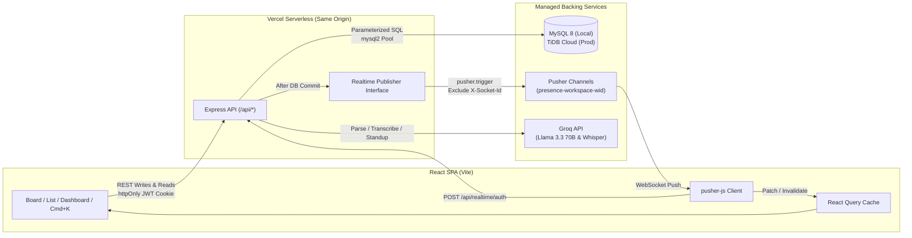
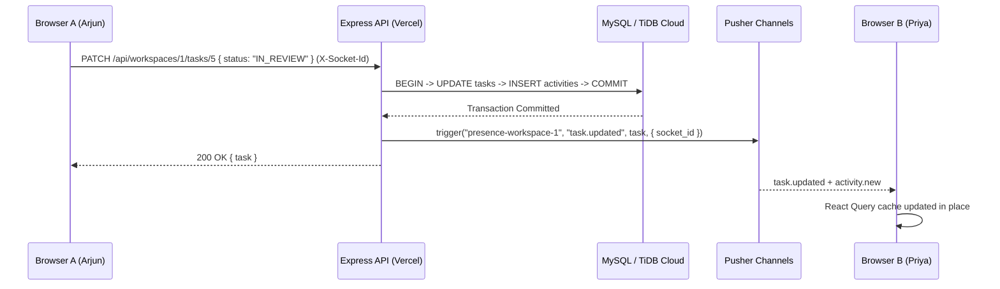
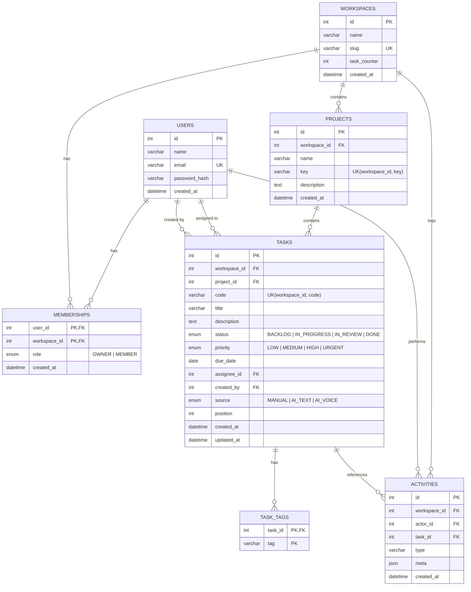

# FlowSpace — AI-Native Multi-Tenant Team Task Workspace

FlowSpace is a multi-tenant team task workspace where teammates can type or speak in plain English or Hinglish to compile structured tasks, move items across a live Kanban board, and generate daily standup reports from real team activity.

- **Frontend:** React 18 (Vite), Tailwind CSS, `@tanstack/react-query`, `@dnd-kit/core`, `pusher-js`
- **Backend:** Node.js + Express (stateless serverless entry on Vercel via `api/index.js`)
- **Database:** MySQL 8 (local) / TiDB Cloud Serverless (production) using `mysql2/promise` with hand-written parameterized SQL and ACID transactions (no ORM)
- **Realtime:** Pusher Channels (`presence-workspace-<wid>`) with server-verified channel authorization and automatic 15-second polling fallback
- **AI:** Groq (`llama-3.3-70b-versatile` JSON mode at `temperature: 0` + `whisper-large-v3` for voice transcription) with strict Zod output contracts

---

## Live Deployment & Demo Credentials

- **Live Application:** `https://flowspace-workspace.vercel.app` *(replace with your deployed Vercel URL)*
- **Workspace:** `FlowSpace Engineering` (`slug: flowspace-eng`)

| Name | Email | Password | Role | Capabilities |
|---|---|---|---|---|
| **Arjun Mehta** | `arjun@flowspace.dev` | `Demo@1234` | `OWNER` | Full workspace access, invite members, create projects, manage tasks, AI command bar & standup |
| **Priya Sharma** | `priya@flowspace.dev` | `Demo@1234` | `MEMBER` | Create, edit, filter, and drag tasks, use AI command bar, voice input & standup |
| **Rahul Verma** | `rahul@flowspace.dev` | `Demo@1234` | `MEMBER` | Create, edit, filter, and drag tasks, use AI command bar, voice input & standup |

> **Tip for testing live sync:** Open two browser windows (one signed in as **Arjun**, one in Incognito signed in as **Priya**). Drag a card across the Kanban board or execute an AI command in one window to observe live board and activity updates in the second window.

---

## Key Features

1. **Multi-Tenant Workspaces & RBAC:**
   - Every user signup provisions an isolated workspace and default project inside a database transaction.
   - Workspace owners (`OWNER`) can add registered teammates (`MEMBER`) by email.
   - Every workspace endpoint and Pusher presence subscription enforces membership verification against `memberships (user_id, workspace_id)`.
2. **AI Command Bar (`Cmd+K`):**
   - Accepts plain English or Hinglish prompts (e.g., *"Create 2 high priority backend tasks for Stripe webhook retry and Redis rate limiting assigned to Priya"* or *"Rahul ke liye kal tak login validation bug fix task banao high priority"*).
   - Never mutates the database directly from an LLM response: follows a strict **Parse → Zod Validate → Interactive Preview → User Confirm → Transactional Execute** workflow.
   - Supports three structured intents: `CREATE_TASKS`, `UPDATE_STATUS` (with candidate disambiguation when multiple tasks match), and `FILTER_TASKS`.
3. **Voice Capture (`MediaRecorder` + Groq Whisper):**
   - Click the **Voice** button (or hold **Right Option / AltRight**) to record up to 60 seconds of speech with a live 5-bar Web Audio waveform.
   - Audio is sent to `POST /api/workspaces/:wid/ai/transcribe` (capped at 4 MB to stay within Vercel's 4.5 MB serverless body limit), transcribed via `whisper-large-v3`, and routed into the same AI preview flow with `source: 'AI_VOICE'`.
4. **AI Daily Standup Generator:**
   - Queries the workspace's last 24 hours of `activities` alongside current task states to produce a structured standup digest (`summary`, `done`, `inProgress`, `blockers`, `overdue`) with one-click Markdown copy.
5. **Kanban Board, List View & Dashboard Analytics:**
   - **Board View:** Drag-and-drop cards across `BACKLOG`, `IN_PROGRESS`, `IN_REVIEW`, and `DONE` with optimistic React Query cache updates and automatic rollback on failure.
   - **List View:** Filter by status, priority, assignee, project, tag, or search text (`title LIKE ?`), with offset pagination.
   - **Dashboard & Activity Feed:** SQL `GROUP BY` status/priority breakdowns, overdue counter, completion rate, and a keyset-paginated live audit trail.

---

## System Architecture



### Realtime Write & Broadcast Sequence



---

## Database Schema & SQL Design (`server/db/schema.sql`)



### Key Database Design Choices

1. **Atomic Human-Readable Task Codes (`FLOW-1`, `FLOW-2`):**
   - Generating sequential codes with `MAX(id) + 1` causes race conditions under concurrent requests.
   - Inside `withTransaction`, `workspaceRepo.incrementTaskCounter` executes `SELECT task_counter FROM workspaces WHERE id = ? FOR UPDATE`, increments `task_counter`, inserts the task and its tags, and logs the activity record before committing.
2. **Composite Indexes Matched to Access Patterns:**
   - `idx_tasks_workspace_status_pos (workspace_id, status, position)`: Covers Kanban column queries and status filtering ordered by position.
   - `idx_tasks_workspace_assignee (workspace_id, assignee_id)`: Accelerates assignee filtering within a workspace.
   - `uq_tasks_workspace_code (workspace_id, code)`: Enforces per-workspace uniqueness and supports `O(log N)` lookup when the AI Command Bar updates a task by code (`Move FLOW-5 to In Review`).
   - `idx_activities_workspace_created (workspace_id, created_at)`: Supports both the 24-hour AI Standup window query and keyset activity pagination.
3. **Referential Integrity & Cascades:**
   - Deleting a task cascades to `task_tags` (`ON DELETE CASCADE`) while setting `activities.task_id` to `NULL` (`ON DELETE SET NULL`) so historical audit logs (`task.deleted`) remain intact.

---

## REST API Reference (Base path: `/api`)

| Method | Endpoint | Auth / Guard | Description |
|---|---|---|---|
| `GET` | `/health` | Public | Returns API status, DB ping latency, and AI/Pusher configuration flags |
| `POST` | `/auth/signup` | `authLimiter` | Creates user, default workspace (`OWNER`), default project, sets `flowspace_token` cookie |
| `POST` | `/auth/login` | `authLimiter` | Verifies bcrypt password hash and sets `httpOnly` JWT cookie |
| `POST` | `/auth/logout` | Public | Clears `flowspace_token` cookie |
| `GET` | `/auth/me` | `requireAuth` | Returns current user, workspaces list, and public Pusher config |
| `GET` | `/workspaces` | `requireAuth` | Lists all workspaces the authenticated user belongs to |
| `POST` | `/workspaces` | `requireAuth` | Creates an additional workspace with the current user as `OWNER` |
| `GET` | `/workspaces/:wid/members` | `requireMembership` | Lists members in workspace `:wid` |
| `POST` | `/workspaces/:wid/members` | `requireMembership`, `requireOwner` | Adds a registered user by email as `MEMBER` or `OWNER` |
| `GET` | `/workspaces/:wid/projects` | `requireMembership` | Lists projects in workspace `:wid` |
| `POST` | `/workspaces/:wid/projects` | `requireMembership` | Creates a new project with a unique key (e.g., `AI`, `CORE`) |
| `GET` | `/workspaces/:wid/tasks` | `requireMembership` | Lists tasks with optional `?status=&priority=&assignee=&projectId=&tag=&q=&page=&limit=` |
| `POST` | `/workspaces/:wid/tasks` | `requireMembership` | Creates a task inside a transaction and broadcasts `task.created` |
| `PATCH` | `/workspaces/:wid/tasks/:id` | `requireMembership` | Updates task fields/status/tags and broadcasts `task.updated` |
| `DELETE` | `/workspaces/:wid/tasks/:id` | `requireMembership` | Deletes task, logs `task.deleted` activity, broadcasts `task.deleted` |
| `GET` | `/workspaces/:wid/stats` | `requireMembership` | Returns total, completed, overdue counts, completion %, and status/priority distributions |
| `GET` | `/workspaces/:wid/activity` | `requireMembership` | Keyset-paginated activity feed (`?before=<id>&limit=20`) |
| `POST` | `/workspaces/:wid/ai/parse` | `aiLimiter`, `requireMembership` | Parses English/Hinglish text into a Zod-validated preview (no DB write) |
| `POST` | `/workspaces/:wid/ai/execute` | `aiLimiter`, `requireMembership` | Executes a user-confirmed AI preview inside a DB transaction |
| `POST` | `/workspaces/:wid/ai/transcribe` | `aiLimiter`, `requireMembership` | Transcribes `multipart/form-data` audio (`<= 4 MB`) via Groq Whisper |
| `POST` | `/workspaces/:wid/ai/standup` | `aiLimiter`, `requireMembership` | Generates a structured daily standup report from the last 24h of activity |
| `POST` | `/realtime/auth` | `requireAuth` | Verifies workspace membership in MySQL and signs Pusher `presence-workspace-<wid>` auth |

---

## Pusher Realtime Events (`presence-workspace-<wid>`)

| Event | Payload | Triggered When | Client Cache Behavior |
|---|---|---|---|
| `task.created` | Full `task` object | Manual task creation or single-task AI creation | Prepends task to active queries and invalidates stats |
| `tasks.bulkCreated` | `{ ids: number[], count: number }` | AI bulk task creation (`> 1` task, keeps payload under Pusher's 10 KB limit) | Invalidates workspace tasks and stats queries |
| `task.updated` | Updated `task` object | Task edit, status change, or Kanban drag-and-drop | Patches task in React Query cache in place |
| `task.deleted` | `{ id: number, code: string }` | Task deletion | Removes task from React Query cache and refreshes stats |
| `activity.new` | Enriched `activity` object | Any task, project, or member mutation | Prepends activity item to live activity feed |
| `pusher:member_added` / `member_removed` | `{ id, info: { name, email } }` | Teammate opens or closes the workspace | Updates live online avatar indicators in TopBar and Sidebar |

---

## How the AI Command Compiler Works

1. **Workspace Context Injection (`/ai/parse`):**
   - The backend loads the workspace's active projects, member list, today's UTC date, and candidate tasks matching any task codes or keywords in the user's prompt.
2. **Deterministic LLM Compilation with Fallback:**
   - Calls Groq `llama-3.3-70b-versatile` in JSON object mode (`temperature: 0`) with an 8-second `AbortController` timeout, 2 exponential backoff retries on `429`/`5xx`, and model fallback to `llama-3.1-8b-instant`.
   - Translates Hindi/Hinglish phrases (e.g., *"kal tak"*, *"banao"*, *"zaroori"*) into clean English task titles and ISO `YYYY-MM-DD` due dates.
   - If `GROQ_API_KEY` is omitted during local evaluation, a deterministic rule-based compiler (`compileFallbackIntent`) parses the command so the preview/confirm workflow still operates offline.
3. **Zod Contract Validation & Disambiguation:**
   - Raw output is normalized (matching member names to `assigneeId` and project keys to `projectId`) and validated against `aiPreviewContractSchema` (`CREATE_TASKS`, `UPDATE_STATUS`, or `FILTER_TASKS`).
   - If an `UPDATE_STATUS` prompt matches multiple tasks (e.g., *"Move the webhook task to Done"*), the response sets `needsClarification: true` with an array of matching candidate tasks.
4. **Interactive Preview & Transactional Execution (`/ai/execute`):**
   - The user reviews the structured preview modal, optionally edits titles/assignees/priorities/dates or selects a disambiguated task, and clicks **Confirm & Execute**.
   - `/ai/execute` re-validates the payload with Zod and commits all writes inside a single MySQL transaction before broadcasting via Pusher.

---

## Scalability Architecture

1. **Stateless Serverless Compute:**
   - The Express application stores zero session or WebSocket state in memory. Authentication uses signed `httpOnly` JWT cookies (`SameSite=Lax`, `Secure` in production), enabling horizontal auto-scaling across Vercel serverless instances.
2. **Offloaded Realtime Transport & Swappable Publisher:**
   - Vercel serverless functions terminate after each HTTP response and cannot hold persistent Socket.io connections. Browser clients maintain persistent WebSocket connections to Pusher Channels, while the API triggers events post-commit.
   - All realtime calls go through `server/src/services/realtime/publisher.js` (`publish`, `authorizePresenceChannel`). Moving to a long-running container environment (ECS/Fly.io/Railway) only requires swapping this single adapter to Socket.io with `@socket.io/redis-adapter`.
3. **Global Connection Pool Caching:**
   - `server/src/config/db.js` caches the `mysql2/promise` pool on `globalThis.__flowspacePool` with `connectionLimit: 5`. Warm serverless invocations reuse existing TLS connections rather than opening a new connection per request.
4. **Query Indexing & Pagination:**
   - Every table is partitioned logically by `workspace_id` with composite indexes (`(workspace_id, status, position)`, `(workspace_id, assignee_id)`, `(workspace_id, created_at)`).
   - Task lists use bounded `LIMIT / OFFSET` pagination (`max 200`), and the activity stream uses cursor/keyset pagination (`WHERE a.id < ? ORDER BY a.id DESC LIMIT ?`) for `O(log N)` performance at arbitrary history depth.
5. **Path to 10,000+ Workspaces:**
   - **Database Horizontal Scaling:** TiDB Cloud separates stateless SQL compute from distributed TiKV storage and scales horizontally while speaking the MySQL protocol. Because every core table carries `workspace_id`, data can be sharded or range-partitioned by `workspace_id`.
   - **Distributed Rate Limiting & Async Queues:** In-memory `express-rate-limit` is per serverless instance; at high traffic, replace the store with **Upstash Redis** (HTTP-based serverless Redis) and offload long batch AI jobs or email notifications to **BullMQ / Upstash QStash**.

---

## Local Setup (5 Commands)

**Prerequisites:** Node.js 20+ and MySQL 8 running locally (`brew services start mysql`).

```bash
git clone <your-repo-url> flowspace && cd flowspace
cp .env.example .env                       # Set your local MySQL DB_PASSWORD (plus optional GROQ_API_KEY & PUSHER_* keys)
npm install && npm --prefix client install
npm run db:setup && npm run db:seed        # Creates tables and seeds demo users + 8 sprint tasks
npm run dev                                # Starts Express API (:4000) + Vite React client (:5173)
```

Run the automated Supertest integration suite:

```bash
npm test
```

---

## Deploying to Production (Vercel + TiDB Cloud + Pusher + Groq)

### 1. Provision Free TiDB Cloud Serverless (MySQL-Compatible)
1. Create a free **TiDB Cloud Serverless** cluster at [tidbcloud.com](https://tidbcloud.com).
2. Click **Connect**, generate a password, and note `DB_HOST`, `DB_PORT` (`4000`), `DB_USER`, and `DB_PASSWORD`.
3. Temporarily point your local `.env` at your TiDB cluster with `DB_SSL=true` and initialize the production schema and demo seed data from your machine:
   ```bash
   npm run db:setup && npm run db:seed
   ```

### 2. Provision Free Pusher Channels Sandbox & Groq API Key
1. In [pusher.com](https://pusher.com), create a Channels app (e.g., cluster `ap2`). Keep **Client Events** disabled so only the authenticated server can broadcast. Copy `app_id`, `key`, `secret`, and `cluster`.
2. In [console.groq.com](https://console.groq.com), create an API key (`GROQ_API_KEY`).

### 3. Deploy Single Project to Vercel
1. Push the `flowspace` repository to GitHub and import it into **Vercel**.
2. `vercel.json` is pre-configured to build `client/dist` and route `/api/*` requests to `api/index.js` (`maxDuration: 30`).
3. Add the following **Environment Variables** in Vercel Project Settings:

| Variable | Production Value |
|---|---|
| `NODE_ENV` | `production` |
| `DB_HOST` | `<your-tidb-host>.tidbcloud.com` |
| `DB_PORT` | `4000` |
| `DB_USER` | `<your-tidb-user>` |
| `DB_PASSWORD` | `<your-tidb-password>` |
| `DB_NAME` | `flowspace` |
| `DB_SSL` | `true` |
| `JWT_SECRET` | `<32+ char random secret>` |
| `GROQ_API_KEY` | `gsk_...` |
| `PUSHER_APP_ID` | `<your-pusher-app-id>` |
| `PUSHER_KEY` | `<your-pusher-key>` |
| `PUSHER_SECRET` | `<your-pusher-secret>` |
| `PUSHER_CLUSTER` | `ap2` |
| `VITE_PUSHER_KEY` | `<your-pusher-key>` |
| `VITE_PUSHER_CLUSTER` | `ap2` |

4. Trigger a deploy and verify `https://<your-vercel-domain>/api/health` returns `"status": "ok"`.
